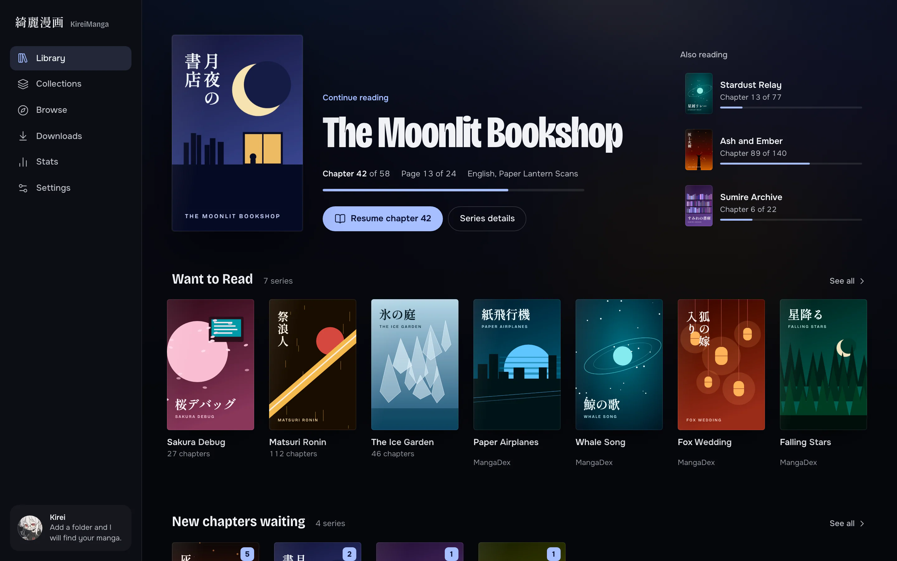
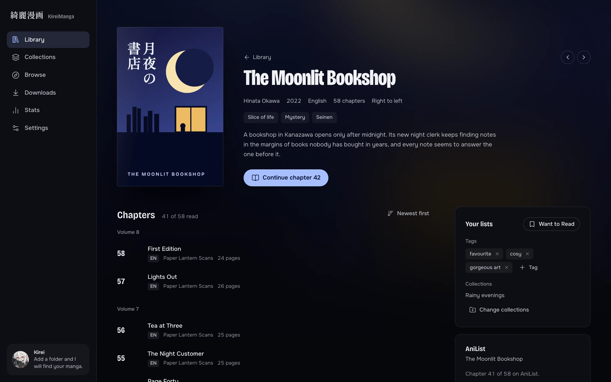
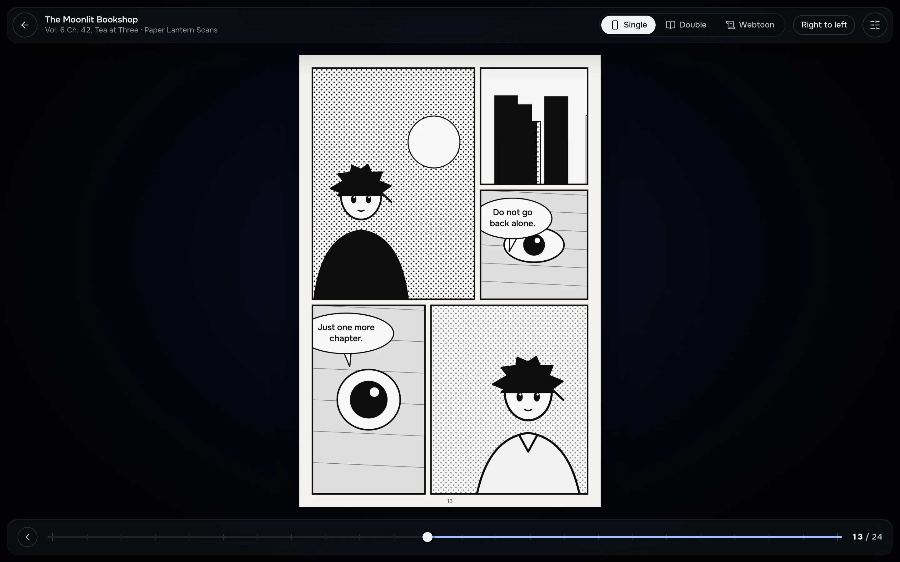
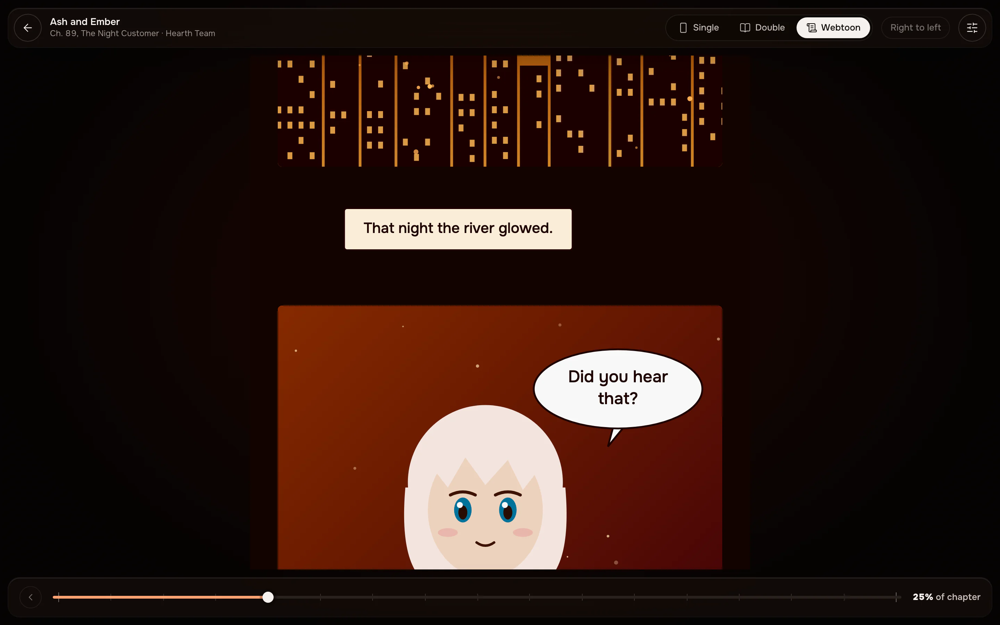
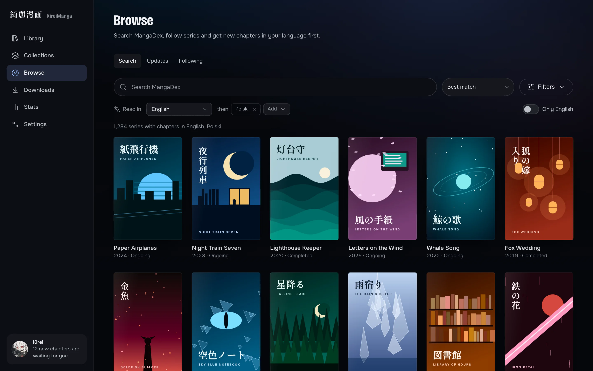
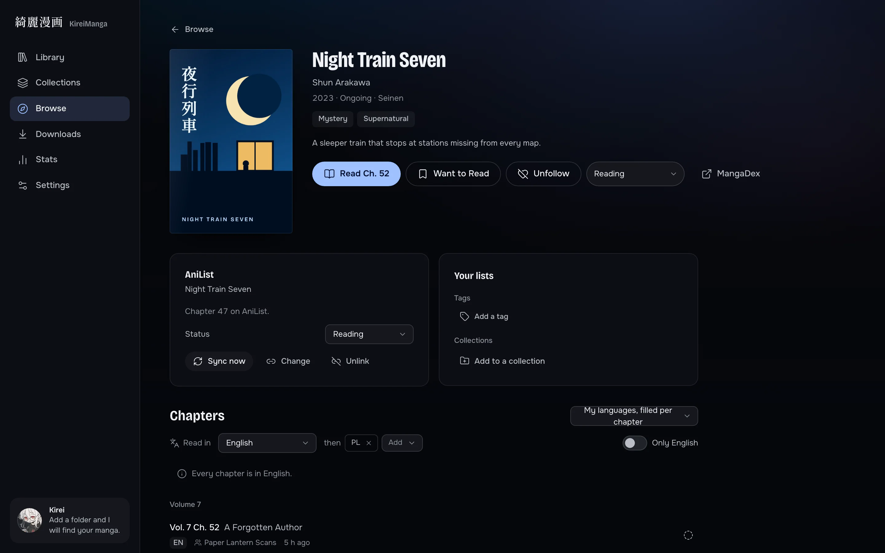
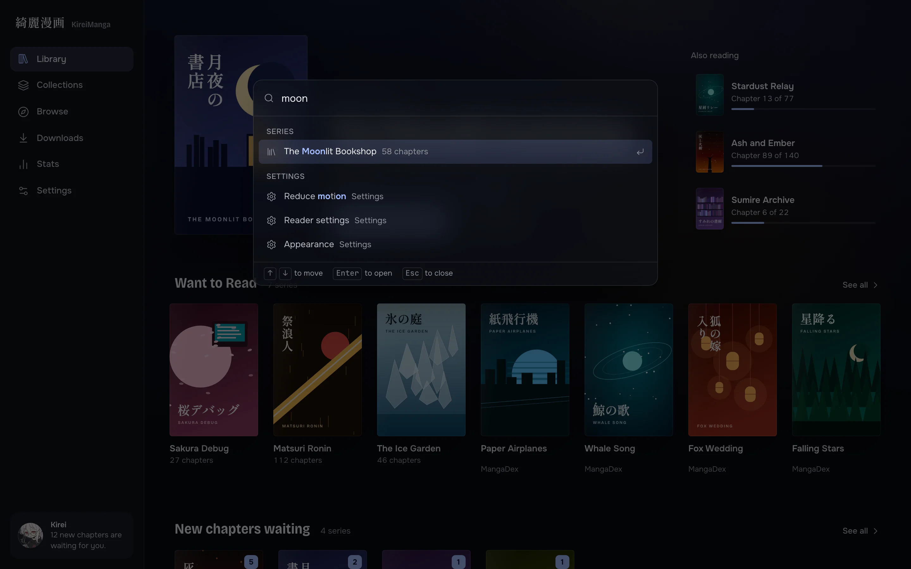
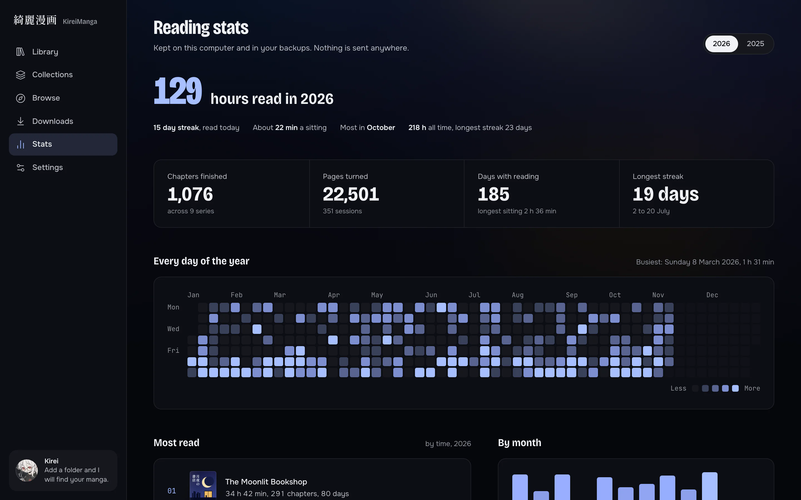

<a name="top"></a>

<div align="center">
  

  <h1>綺麗漫画 &nbsp;·&nbsp; KireiManga</h1>

  <p><strong>A quiet, fast desktop manga reader for Windows and macOS.</strong></p>

  <p>
    <a href="https://github.com/Shironex/kirei-manga/releases/latest">
      
    </a>
    <a href="https://github.com/Shironex/kirei-manga/releases">
      
    </a>
    
    <a href="LICENSE">
      
    </a>
  </p>

  <p>
    <a href="https://github.com/Shironex/kirei-manga/releases/latest"><strong>Download</strong></a>
  </p>
</div>

---

## What is KireiManga?

KireiManga is a local-first manga reader built with Tauri 2, Rust and React. I wrote it because I wanted one app for the CBZ files on my disk and the series I follow on MangaDex, one that opens instantly and stays out of the way.

Archives (CBZ, ZIP, CBR) and image folders are read in place and streamed page by page, never extracted to disk. The catalogue lives in a local SQLite database, and MangaDex, downloads and AniList are built on the same reader and library. There is no telemetry, no ads and no scraper sources: only local files and official APIs.

The first version of KireiManga was an Electron app. I rewrote it from scratch in Rust and Tauri; the old code is kept under the [`legacy-electron`](https://github.com/Shironex/kirei-manga/tree/legacy-electron) tag.

## Screenshots

<table>
  <tr>
    <td align="center" width="50%">
      
      <br />
      <em>Library: continue reading, Want to Read and pinned smart filters</em>
    </td>
    <td align="center" width="50%">
      
      <br />
      <em>Series page: tags, collections and AniList progress</em>
    </td>
  </tr>
  <tr>
    <td align="center" width="50%">
      
      <br />
      <em>Reader: single page, right to left</em>
    </td>
    <td align="center" width="50%">
      
      <br />
      <em>Reader: webtoon strip</em>
    </td>
  </tr>
  <tr>
    <td align="center" width="50%">
      
      <br />
      <em>Browse MangaDex</em>
    </td>
    <td align="center" width="50%">
      
      <br />
      <em>A MangaDex series, with chapters and scanlation groups</em>
    </td>
  </tr>
  <tr>
    <td align="center" width="50%">
      
      <br />
      <em>Command palette (Ctrl+K or Cmd+K)</em>
    </td>
    <td align="center" width="50%">
      
      <br />
      <em>Reading stats and the year in review</em>
    </td>
  </tr>
</table>

The screenshots are captures of the real interface made by `pnpm shots`, using invented demo data (see [docs/screenshots.md](docs/screenshots.md)).

## Highlights

|                          |                                                                                                                                                                                                                                   |
| ------------------------ | --------------------------------------------------------------------------------------------------------------------------------------------------------------------------------------------------------------------------------- |
| **Local library**        | CBZ, ZIP, CBR and image folders, read in place and streamed. Library folders are watched, and changes made while the app was closed are picked up at launch. Your files are only ever read.                                       |
| **Reader**               | Single page, double page (with spread detection) and webtoon modes, left to right or right to left, fit modes, remappable keys, per-series memory of your choices.                                                                |
| **Comfort options**      | Resampling filters, brightness, contrast, saturation, sharpen, invert, grayscale and sepia, tall strips split into screen sized parts, webtoon chapters that run into the next one.                                               |
| **Cover colours**        | The theme and the reader chrome take their tint from the cover of the series in focus, held to AA contrast. It can be switched off.                                                                                               |
| **MangaDex**             | Browse and search, follow series, a grouped feed of new chapters, notifications, a language chain (Polish then English by default) and an "only my language" toggle. Signing in syncs follows, reading statuses and read markers. |
| **Offline downloads**    | A resumable download queue that writes each chapter as a CBZ with `ComicInfo.xml` into a folder the library watches, with rate controls and a data saver option.                                                                  |
| **AniList tracking**     | Sign in through the browser, link a series, and your progress is sent when you finish a chapter. Updates made offline are queued.                                                                                                 |
| **Organise**             | Collections, tags, a Want to Read list, bulk edit, and smart filters that update themselves and can be pinned to the home screen.                                                                                                 |
| **Command palette**      | Ctrl+K (Cmd+K on macOS) finds series, collections, filters, tags, screens and MangaDex titles.                                                                                                                                    |
| **Reading stats**        | Time read, streaks, a heatmap, top series and a year in review card you can save as an image. Everything stays on your computer.                                                                                                  |
| **Backups and portable** | Back up and restore the library to a single file, or run a portable copy that keeps all its data in a `data` folder next to the app.                                                                                              |
| **Updates**              | Signed updates installed from Settings, with a separate prerelease channel.                                                                                                                                                       |

Every chapter read from MangaDex shows its scanlation groups. Design notes and the details behind each feature live in [docs/](docs/).

## Install

Download the installer for your system from the [latest release](https://github.com/Shironex/kirei-manga/releases/latest).

The release builds are not code signed yet, so both systems ask you to allow the app once. The in-app updater works either way, because updates are verified with their own signature.

### Windows

1. Download `KireiManga_<version>_x64-setup.exe` and run it. It installs per user.
2. Windows SmartScreen may warn that the publisher is unknown. Click **More info**, then **Run anyway**.

### macOS

macOS 11 or newer, Apple silicon or Intel.

1. Download the `.dmg` for your chip (`aarch64` for Apple silicon, `x64` for Intel), open it and drag KireiManga to Applications.
2. The app is not signed with a Developer ID and not notarized, so Gatekeeper blocks the first launch. Right-click KireiManga in Applications, choose **Open**, then **Open** again in the dialog. If macOS only offers to move it to the Bin, open **System Settings > Privacy & Security** and choose **Open Anyway** next to the message about KireiManga.
3. From a terminal you can clear the quarantine flag instead: `xattr -cr /Applications/KireiManga.app`.

There is no Linux build for now.

## Build from source

You will need:

- [Node.js](https://nodejs.org/) 22 or newer
- [pnpm](https://pnpm.io/) 10 (the repo pins `pnpm@10.34.9`; with corepack enabled, `corepack enable` picks it up)
- [Rust](https://rustup.rs/) through rustup. The toolchain is pinned in `rust-toolchain.toml` (1.94.1 with rustfmt and clippy) and installed on first use.
- The [Tauri 2 prerequisites](https://v2.tauri.app/start/prerequisites/): Xcode command line tools on macOS, the Visual Studio C++ build tools and WebView2 on Windows.

```bash
git clone https://github.com/Shironex/kirei-manga.git
cd kirei-manga
pnpm install
pnpm dev
```

<details>
<summary>All commands</summary>

```bash
pnpm dev               # Tauri app with hot reload
pnpm dev:web           # the React UI alone in a browser (no Rust core)
pnpm build             # build the desktop frontend
pnpm tauri build       # package the installer for your platform
pnpm typecheck         # TypeScript
pnpm test              # Vitest
pnpm lint              # ESLint
pnpm format:check      # Prettier
cargo test --workspace # Rust tests
cargo clippy --workspace --all-targets -- -D warnings
pnpm dev:landing       # the Astro landing site
pnpm shots             # regenerate assets/screenshots
pnpm notices           # regenerate THIRD_PARTY_NOTICES
```

</details>

AniList sign in needs a client id at build time; see [docs/tracking.md](docs/tracking.md). A build without it works, with the AniList sign in button disabled.

### Project structure

```
kirei-manga/
├── apps/
│   ├── desktop/      # Tauri 2 app: Rust shell in src-tauri, React 19 UI in src
│   └── landing/      # Astro site for kireimanga.app
├── crates/
│   ├── kirei-core/       # shared types, settings, data paths
│   ├── kirei-archive/    # streaming CBZ, ZIP, CBR and folder access
│   ├── kirei-reader/     # decode-ahead page pipeline
│   ├── kirei-library/    # SQLite catalogue, scanner, covers, stats
│   ├── kirei-mangadex/   # MangaDex API client
│   ├── kirei-download/   # resumable download queue
│   └── kirei-anilist/    # AniList client
├── docs/             # how each part works, release process, design notes
└── assets/           # icon and screenshots
```

Built with Tauri 2, Rust, React 19, Vite, Tailwind CSS v4 and SQLite. Start with [docs/spec.md](docs/spec.md) for the decisions behind the design.

## MangaDex notice

KireiManga is an unofficial client. It is not affiliated with, endorsed by or sponsored by MangaDex. It uses the public MangaDex API, credits the scanlation groups of every chapter you read, shows no ads and does not sell or paywall any content from the API. If MangaDex or a rights holder asks for something to be taken down, I will honour it.

## Credits

- [MangaDex](https://mangadex.org) and the scanlation groups behind the chapters it hosts, for the catalogue and the work of translating and uploading it.
- [AniList](https://anilist.co) for its public GraphQL API.
- The fonts are bundled under the SIL Open Font License; their licences are in `apps/desktop/src/assets/fonts`.
- KireiManga inherits its design language and tooling from my other projects, [ShiroAni](https://github.com/Shironex/shiroani) and Shiranami.

## License

Source-available, see [LICENSE](LICENSE). Personal use and contributions via pull requests are permitted; redistribution and derivative works are not.

Third party licences, including the UnRAR licence for CBR support, are listed in [THIRD_PARTY_NOTICES](THIRD_PARTY_NOTICES). Regenerate it with `pnpm notices`.

<p align="right"><a href="#top">Back to top ↑</a></p>
