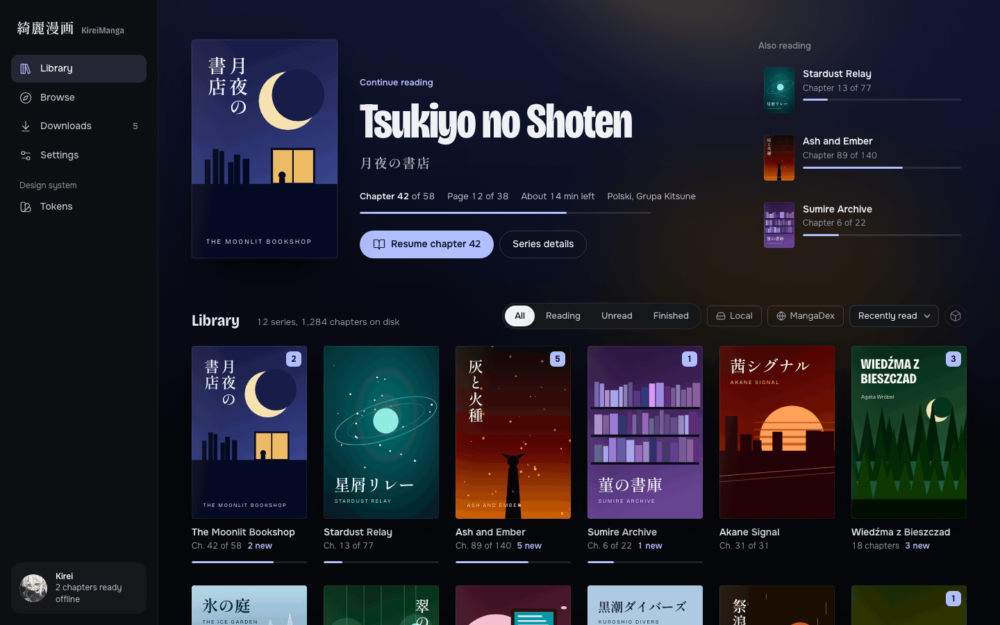
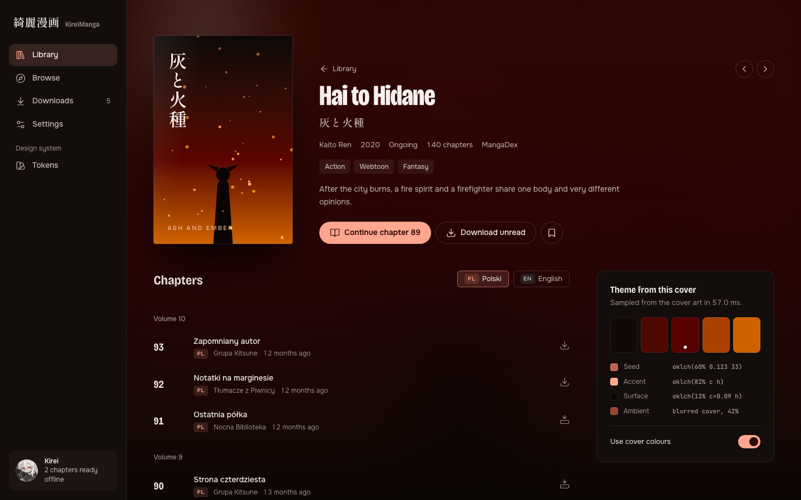
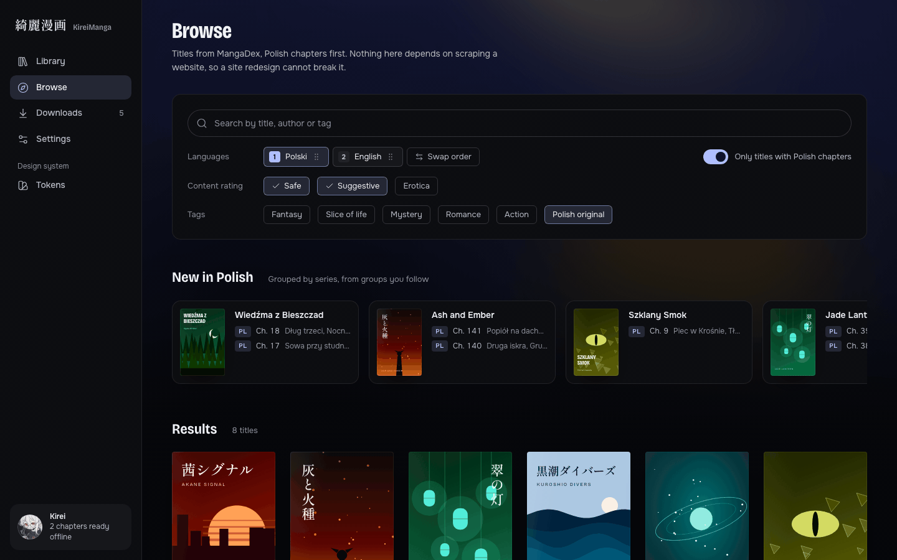
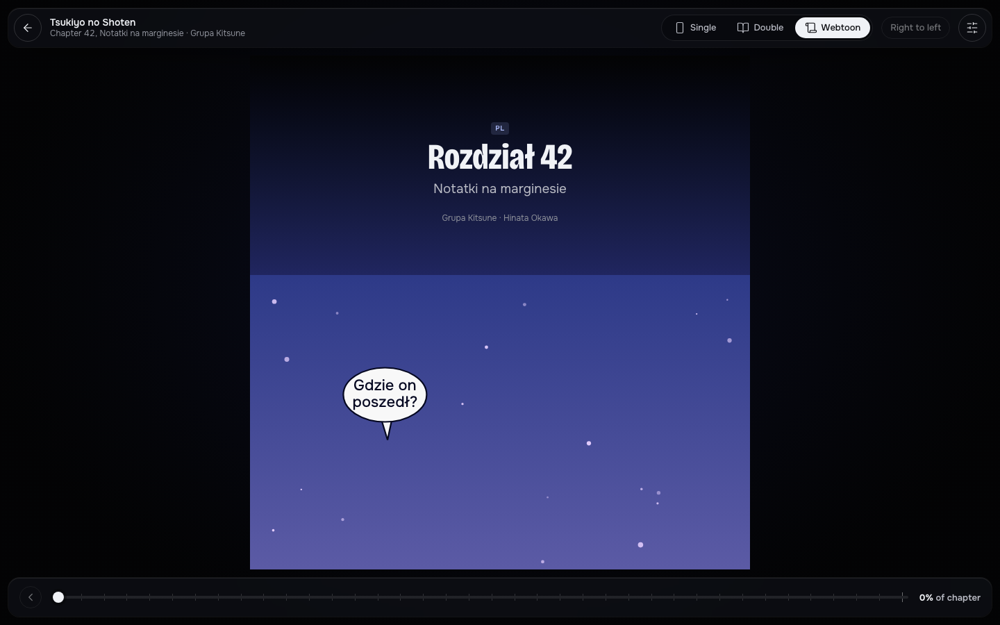
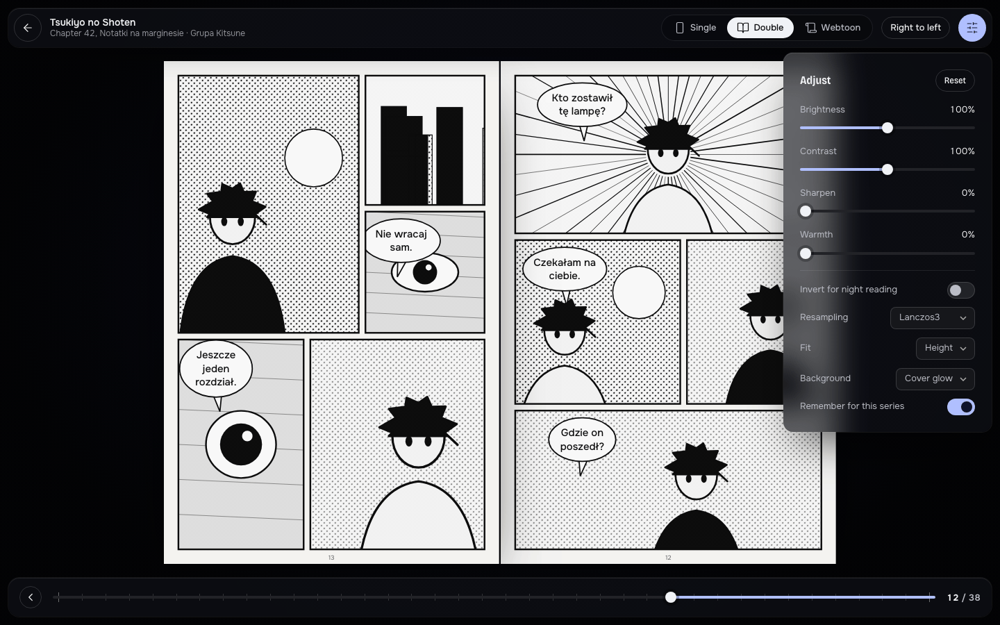

# KireiManga design

The approved UI direction for KireiManga 1.0, as an interactive prototype plus the tokens it is built from.

## Direction

A dark, cinematic gallery. The covers are the colour in the app, so the interface stays quiet around them.

- **One seed drives all colour.** A hue and a chroma are sampled from the current cover, and every surface, accent and glow is derived from them in OKLCH. Lightness is fixed per role, so contrast stays the same while the colour changes.
- **Strength setting.** Subtle (0.6), balanced (1) or vivid (1.35) scales how much of the seed shows up.
- **Glass is rare.** Only reader chrome and floating panels use it. With reduced transparency it falls back to a solid surface.
- **Semantic colours** (ok, warn, error) are never derived from the cover.

## Type

| Role               | Font                                           |
| ------------------ | ---------------------------------------------- |
| Titles             | Bricolage Grotesque, condensed (wdth 75 to 88) |
| UI                 | Onest                                          |
| Japanese titles    | Shippori Mincho                                |
| Tokens and numbers | JetBrains Mono                                 |

The scale runs from 12 px (`--t-xs`) to 72 px (`--t-6xl`). Spacing uses a 4 px base.

## Radius

Covers 4 px, chips 6 px, panels 14 px, buttons are pills.

## Motion

Interaction transitions use 120, 200 and 320 ms with an expo-out curve. The palette crossfade between covers takes 900 ms with ease-in-out. Reduced motion collapses these to 1 ms.

## Screens

Library, Browse, Series detail, Reader (single, double and webtoon modes, with adjust panel), Downloads, Settings, About and Tokens. The shell has a left rail and ambient cover glow behind the content.

| Library                                   | Series                                           |
| ----------------------------------------- | ------------------------------------------------ |
|  |     |
|    |  |

## Files

| File               | What it is                                                              |
| ------------------ | ----------------------------------------------------------------------- |
| `prototype.html`   | The interactive prototype. Open it in a browser.                        |
| `tokens.css`       | The design tokens (dark), copied from the Tokens page of the prototype. |
| `coming-soon.html` | Source of the placeholder page live on kireimanga.app.                  |
| `screenshots/`     | Captures of the prototype and the coming-soon page.                     |

## Using it

Open `prototype.html` in a browser. It loads its fonts from Google Fonts and icons from a CDN, so it needs a network connection to look right. All covers, pages and strips are fictional SVG art generated in the file.

`tokens.css` is the source for the design tokens work in issue #25. Tailwind v4 maps the variables with `@theme inline`. The seed variables (`--seed-h`, `--seed-c`, `--strength`) are written at runtime from the sampled cover.

## Cover theming in the app

`apps/desktop/src/lib/theme/coverTheme.ts` decides which cover is in focus. The series page puts its own cover there, and the library puts the cover of the series it would resume. Hovering or keyboard focusing another cover previews it after 140 ms, and leaving drops back 500 ms later, so sweeping across the grid does not strobe. The seed is written once at the app root (`useCoverTheme`), and the registered seed properties crossfade in 900 ms (instantly with reduced motion). The focus outlives the page, so the reader opened from a series keeps that series' colours.

Every stored palette is mapped into the range the contrast test covers: the hue is wrapped into 0 to 360 and the chroma is clamped to `SEED_CHROMA_MAX`. Covers with no palette get the default seed. The ambient backdrop puts the blurred cover behind the page top, dimmed to the ceiling in `lib/theme/ambient.ts`. `contrast.test.ts` holds hero text at AA over a pure white cover at every strength, so raise that ceiling only together with the test. The `appearance.coverColours` setting turns all of this off.
